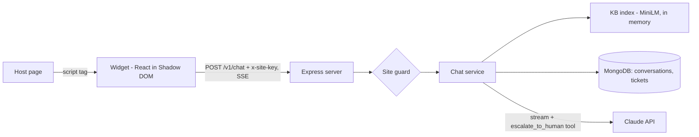

# ai-support-widget

Embeddable AI support chat widget with streaming replies, conversation memory, a knowledge base and human handoff.

[](https://github.com/Muhaman/ai-support-widget/actions/workflows/ci.yml)

## What it does

- A single `support-widget.js` script adds a chat launcher to any page. It renders inside a Shadow DOM, so host-page CSS cannot affect it.
- Replies stream token by token over Server-Sent Events. The conversation id is kept in `localStorage`, and history is restored on reload.
- The server embeds a markdown FAQ at boot, retrieves the best matching sections for each message and gives them to Claude as context.
- Claude can call an `escalate_to_human` tool. That opens a ticket in MongoDB, emits an `escalated` event, and the model then writes a short handoff message.
- Each site is identified by a key and an allowed-origin list; anything else gets a 403.

The sample knowledge base (`server/kb/`) is a **fictional** "Acme Cloud" FAQ written for this demo.

## Architecture



## Quickstart

```bash
cp .env.example .env            # set ANTHROPIC_API_KEY
export ANTHROPIC_API_KEY=...
docker compose up --build       # mongo, server on :3000, demo page on :8080
```

Open http://localhost:8080 and use the launcher. The first server start downloads the embedding model into a volume.

Without Docker: `npm install`, start MongoDB, `npm run dev:server`, and `npm run build -w widget` (output: `widget/dist/support-widget.js`).

## Usage

Auto-init from the script tag:

```html
<script src="support-widget.js" data-site-key="pk_demo" data-api-url="http://localhost:3000"></script>
```

Or programmatically (`title` and `primaryColor` are optional):

```js
SupportWidget.init({ siteKey: "pk_demo", apiUrl: "http://localhost:3000", title: "Acme Support", primaryColor: "#2563eb" });
```

Sites are configured with `SITES_JSON`:

```json
[{ "siteKey": "pk_demo", "name": "Acme Cloud (demo)", "origins": ["http://localhost:8080"] }]
```

API (all requests need `x-site-key` and a matching `Origin`):

```bash
curl -N http://localhost:3000/v1/chat \
  -H 'content-type: application/json' -H 'x-site-key: pk_demo' -H 'origin: http://localhost:8080' \
  -d '{"message":"How do I reset my password?"}'
# event: meta      data: {"conversationId":"..."}
# event: text      data: {"text":"..."}          (repeated)
# event: escalated data: {"ticketId":"..."}      (only on handoff)
# event: done      data: {}                      (or event: error {code, message})

curl http://localhost:3000/v1/conversations/<id> -H 'x-site-key: pk_demo' -H 'origin: http://localhost:8080'
```

## Design decisions & trade-offs

- **Streaming plus a client tool.** Each model turn streams; if it ends in `escalate_to_human`, the server runs the tool, appends the full assistant content and a `tool_result`, and continues the stream so the handoff message reaches the user in the same SSE response. The tool is `strict: true` with `eager_input_streaming`; because eager streaming skips server-side validation, the input is re-validated with zod before a ticket is created. `tool_choice` stays `auto`.
- **No fixed reply on a KB miss.** A support bot should still answer a greeting, so the system prompt says no relevant articles were found and tells the model to offer a handoff instead of guessing.
- **In-memory KB index.** A FAQ-sized corpus does not need a vector database; cosine similarity over a few dozen vectors is instant. A large corpus would need Atlas Vector Search or similar.
- **Explicit stream failures.** Refusals, truncation and upstream errors become an SSE `error` event; the widget also treats a stream that ends without `done` as an error and offers a retry. A client disconnect aborts the upstream request.
- **Site key is not a secret.** It identifies the site; the Origin allowlist is the control, and it only stops browsers (non-browser clients can forge `Origin`). Rate limiting is per IP.
- **Fallback only where supported.** The server-side refusal fallback is sent only for `claude-opus-5-5` and `claude-sonnet-5-5`.

## Testing

```bash
npm install
npm run lint && npm run typecheck && npm test
```

Server tests use `mongodb-memory-server` (downloads a `mongod` binary on first run), a fake LLM and a deterministic fake embedder. Widget tests use Vitest, React Testing Library and jsdom. CI runs all of this plus Docker builds.

## Limitations & next steps

- A retry after a failed reply re-sends the user message, so the stored history can contain it twice.
- Conversation history is stored in full but only the last 20 messages are sent to the model; there is no summarisation.
- Tickets are only stored; there is no agent inbox or notification integration.
- No authentication of end users and no per-site rate limits.
- Tool turns are not persisted; only the final user and assistant text is.

## License

MIT
